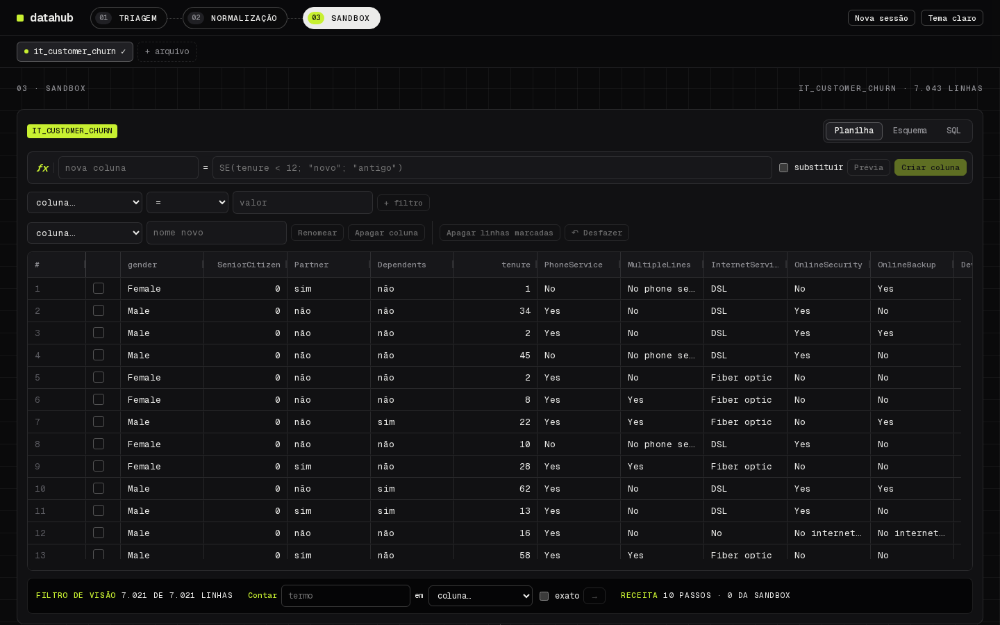
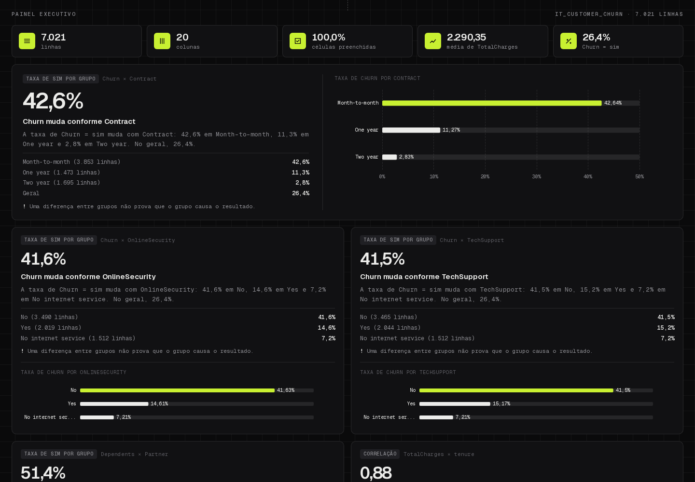
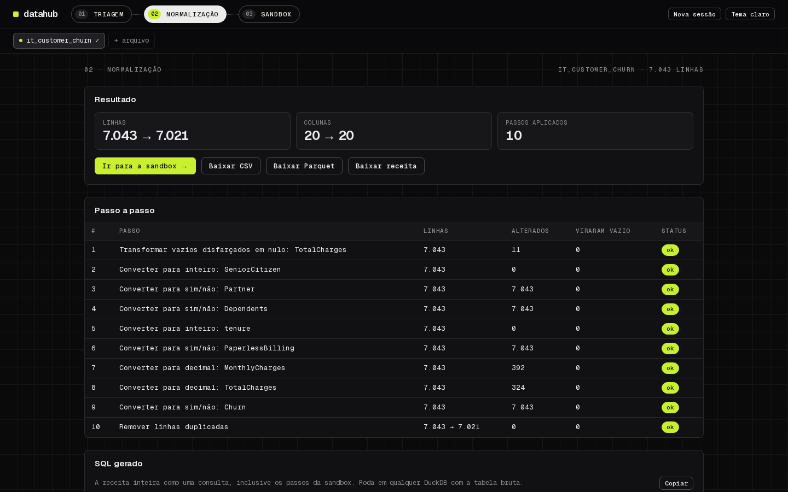
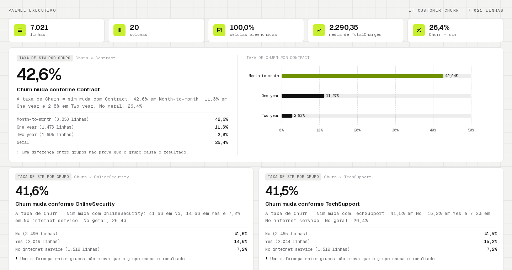

# Tabula rasa

[](https://github.com/gabriellduarte-hash/datahub/actions/workflows/testes.yml)
[](https://github.com/gabriellduarte-hash/datahub/releases/latest)

Limpeza, sandbox e insights de planilhas, **sem IA**: regras, estatística e SQL. Você envia um CSV, Excel ou Parquet; o hub mostra como o arquivo chegou, sugere uma receita de limpeza, deixa editar os dados como numa planilha e monta um painel com os achados que passam do acaso.



## Experimente

**[Abrir o Tabula rasa no navegador →](https://gabriellduarte-hash.github.io/datahub/)**

O site roda o motor inteiro dentro do seu navegador, sem servidor: o arquivo que você envia não sai do seu computador. A primeira visita leva alguns segundos para carregar o motor; depois o navegador guarda.

| Outro jeito | Para quem | Como |
|---|---|---|
| **Executável** | Quem quer arquivos maiores ou usar sem internet | Baixe o arquivo do seu sistema em [Releases](https://github.com/gabriellduarte-hash/datahub/releases/latest), descompacte e abra. O hub abre no navegador e os arquivos não saem do seu computador. |
| **GitHub Codespaces** | Quem tem conta no GitHub e não quer instalar nada | [](https://codespaces.new/gabriellduarte-hash/datahub?quickstart=1) Em uns 2 minutos o hub abre numa aba. Usa a cota gratuita do Codespaces de quem abre. |
| **Código** | Quem quer ler ou mudar | Veja [Rodar](#rodar). |

Sem arquivo à mão? Clique em **Usar vendas de exemplo**: 5 mil pedidos com sujeira de verdade e efeitos de negócio plantados.

## O que ele faz

1. **Triagem:** lê o arquivo e mostra o perfil de cada coluna (tipo, vazios, valores típicos, papel na análise).
2. **Normalização:** sugere uma receita de limpeza (números em formato brasileiro, sim/não, datas, duplicadas, vazios disfarçados) e mostra o SQL que ela gera.
3. **Sandbox:** os dados em cima, em três vistas (planilha editável com fórmulas em português, esquema das tabelas e SQL), e o painel executivo embaixo, com cada insight ao lado do gráfico do dado que ele cita.



## Destaques técnicos

- **Insights sem descobertas falsas.** Cada analisador testa se o efeito passa do acaso, desconta o volume e ignora regras de cadastro (como "quem não tem telefone está em Sem telefone"). Em 180 bases de puro ruído, o hub não reportou nenhum achado.
- **Receita que vira SQL.** Toda limpeza e edição é um passo de uma receita, compilada para uma consulta DuckDB que roda em qualquer lugar. Desfazer é tirar o último passo.
- **Fórmulas do Excel em português**, como `SE(tenure < 12; "novo"; "antigo")`, traduzidas para SQL por um analisador próprio, com mensagens que dizem onde está o erro. Inclui `CONVERTER` de moedas com o histórico do Banco Central Europeu.
- **Junções que não inflam somas.** Relações entre tabelas só trazem colunas do lado onde a chave é única. No sentido errado, o hub recusa e oferece um resumo.
- **Roda no navegador, sem servidor.** O mesmo motor em Python e a mesma API FastAPI rodam no Pyodide (Python compilado para WebAssembly), num Web Worker. A interface troca a rede por uma ponte (`navegador/ponte.py`) e o site é só arquivos estáticos no GitHub Pages. O CI roda os testes do motor dentro do Pyodide para isso não quebrar.
- **Pronto para o público.** No modo público, envios grandes são cortados enquanto chegam, cada visitante tem limites, as análises entram numa fila e o SQL do usuário não lê arquivos do servidor.
- **Rápido.** Na máquina de desenvolvimento, a análise completa de 1 milhão de linhas leva 10 segundos, e a de 10 milhões, 1 minuto.
- **Testado.** 239 testes, com dados fabricados que trazem o gabarito do que foi plantado.

**Pilha:** Python, DuckDB e FastAPI no motor e na API; Next.js, React, AG Grid, React Flow, CodeMirror e ECharts na interface.

| Normalização | Tema claro |
|---|---|
|  |  |

Uma sessão pode ter várias tabelas: arquivos, abas do Excel, consultas salvas e arquivos empilhados. As cotações são do Banco Central Europeu e ficam em `engine/dados/`.

## Blocos da engine

| Bloco | O que faz | Código |
|---|---|---|
| Arquivo | Lê CSV, TSV, TXT, XLSX ou Parquet, numera as linhas e aplica os limites | `engine/leitura.py` |
| Perfil | Descobre tipos, papéis, vazios e duplicatas | `engine/perfil.py`, `engine/tipos.py` |
| Normalização | Sugere passos e aplica a receita, gerando SQL | `engine/normalizacao.py` |
| Sandbox | Edita células, apaga e filtra linhas, renomeia, cria colunas por fórmula | `engine/manipulacao.py`, `engine/formulas.py` |
| Gráficos | Recomenda gráficos e calcula os dados no DuckDB | `engine/graficos.py` |
| Insights | Catálogo de analisadores com evidências e ressalvas | `engine/insights.py` |

Outros módulos:

- `engine/area.py`: a sessão com várias tabelas e a base de análise.
- `engine/relacional.py`: relações, a visão que junta tabelas e o empilhamento.
- `engine/consulta.py`: a vista SQL, só de consulta.
- `engine/cambio.py`: as cotações para a fórmula `CONVERTER`.
- `engine/pipeline.py`: liga os blocos.
- `api/`: expõe a engine.
- `web/`: a interface.

## Regras que protegem os dados

- **Receita:** toda mudança de dados vira um passo da receita, que continua reproduzível e mostra o SQL. Desfazer tira o último passo.
- **Número de linha:** cada linha leva o número que tinha no arquivo (`__linha`), e edições apontam para ele.
- **Fórmulas:** valem para a coluna inteira. Fórmula por célula, como `=A2*B7`, não existe de propósito.
- **Vista SQL:**
  - roda só `SELECT` e `WITH`, um comando por vez, sem acesso ao disco e com tempo limite;
  - um resultado pode ser salvo como tabela nova ou como arquivo `.sql`.
- **Base única:** gráficos e insights olham para uma base só, seja uma tabela ou uma visão que junta tabelas.
  - A visão só traz colunas do lado onde a chave é única.
  - Uma junção que repetiria linhas é recusada; no lugar, a visão traz um resumo (contagem e somas por chave).

## Fórmulas

Escritas como no Excel em português. Argumentos são separados por `;`, e a vírgula pode ser decimal. Colunas com espaço vão entre colchetes, como `[Average Cost for two]`.

| Tipo | Funções |
|---|---|
| Lógica | `SE`, `E`, `OU`, `NAO`, `SEVAZIO`, `EVAZIO` |
| Números | `ARRED`, `ABS`, `RAIZ`, `POTENCIA`, `LN`, `INT`, `MOD`, `VALOR` |
| Totais | `SOMA`, `MEDIA`, `MAXIMO`, `MINIMO`: com um argumento, o total da coluna; com vários, a conta na linha |
| Totais por critério | `MEDIANA`, `CONT`, `CONT.SE`, `SOMASE` |
| Texto | `MAIUSCULA`, `MINUSCULA`, `ARRUMAR`, `NUM.CARACT`, `ESQUERDA`, `DIREITA`, `EXT.TEXTO`, `SUBSTITUIR`, `CONCATENAR`, `CONTEM`, `TEXTO` |
| Datas | `ANO`, `MES`, `DIA`, `DIA.DA.SEMANA`, `HOJE`, `DATA`, `DIAS` |
| Moedas | `CONVERTER(valor; moeda; destino [; data ou ano])` |

Os nomes em inglês também funcionam, como `IF`, `ROUND`, `SUM` e `COUNTIF`.

`CONVERTER` tem três modos:

- sem data, usa a cotação mais recente;
- com uma data, usa a cotação daquele dia;
- com um ano, como `ANO(data)`, usa a média do ano.

As cotações são do Banco Central Europeu e ficam em `engine/dados/`.

## Rodar

Só na primeira vez:

```bash
python3 -m venv .venv
.venv/bin/pip install -e ".[dev]"
```

Para abrir o hub (API na porta 8000 e interface na 3000):

```bash
./dev.sh
```

Depois acesse http://localhost:3000. `Ctrl+C` encerra tudo.

Para rodar num endereço só, como no Codespaces, use `./servir.sh` (porta 8000).

Para montar o site que roda no navegador: `python navegador/empacotar.py` e, em `web/`, `DATAHUB_EXPORTAR=1 NEXT_PUBLIC_MOTOR=navegador NEXT_PUBLIC_API_URL= npm run build`. O GitHub Actions faz isso e publica no GitHub Pages a cada envio para a `main`. Para testar o motor no Pyodide: `cd navegador && npm ci && node testar.mjs`.

Para montar o executável do seu sistema: exporte a interface (`cd web && DATAHUB_EXPORTAR=1 NEXT_PUBLIC_API_URL= npm run build`), instale o PyInstaller e rode `pyinstaller datahub.spec`. O GitHub Actions faz isso para Windows, macOS e Linux a cada versão marcada com `git tag v…`.

Para atualizar as cotações de câmbio:

```bash
.venv/bin/python -m engine.cambio atualizar
```

## Testar

```bash
.venv/bin/pytest
.venv/bin/python -m samples.benchmark 100000 1000000
```

`samples/gerar_vendas.py` fabrica um CSV com sujeira e efeitos de negócio plantados, e um gabarito do que plantou. Os testes usam esse gabarito para conferir se o hub acertou, e dados de puro ruído para conferir que ele não inventa descobertas.

## Limites

Ficam em `engine/limites.py`.

- **Carga:** protegem a máquina. São 10 milhões de linhas, 500 colunas e um teto de células.
- **Análise:** protegem os insights. Bases de até 200 mil linhas se reanalisam sozinhas depois de uma edição.
- **Site público:** `DATAHUB_MODO=publico` liga os limites próprios dele: arquivos de até 50 MB, 2 milhões de linhas e 30 milhões de células.

## Publicar

O `Dockerfile` gera uma imagem com o hub inteiro. A interface vira arquivos estáticos e a API os serve no mesmo endereço, então não há CORS nem dois serviços para manter. A imagem já liga o modo público.

```bash
podman build -t tabula-rasa .
podman run --rm -p 8080:8080 tabula-rasa   # http://localhost:8080
```

No modo público, `api/publico.py` e `api/sessoes.py` protegem a máquina:

- um envio acima do limite é cortado enquanto chega, sem ocupar o disco;
- cada visitante tem um limite de pedidos por minuto e de sessões novas por hora;
- poucas análises rodam ao mesmo tempo, e as outras esperam na fila;
- as sessões duram menos e têm um teto. Com o teto cheio, as paradas há mais de 30 minutos dão lugar às novas;
- a configuração do DuckDB fica travada, e nem o SQL do usuário religa o acesso a arquivos.

Cada número pode ser trocado por uma variável de ambiente, para caber na máquina contratada:

| Variável | Padrão no modo público | O que controla |
|---|---|---|
| `DATAHUB_MEMORIA` | `1GB` | Memória do DuckDB por análise |
| `DATAHUB_TRABALHOS` | `2` | Análises ao mesmo tempo |
| `DATAHUB_THREADS` | `2` | Núcleos que cada análise usa |
| `DATAHUB_HORAS` | `6` | Vida de uma sessão parada |
| `DATAHUB_MAX_SESSOES` | `150` | Sessões guardadas ao mesmo tempo |
| `DATAHUB_PEDIDOS_MINUTO` | `600` | Pedidos por visitante por minuto |
| `DATAHUB_SESSOES_HORA` | `20` | Sessões novas por visitante por hora |
| `DATAHUB_IP_CABECALHO` | nenhum | Cabeçalho com o IP do visitante, como `fly-client-ip` |
| `DATAHUB_SESSOES` | `/tmp/sessoes` | Pasta das sessões |

Conta de memória: análises ao mesmo tempo × memória por análise, mais uns 300 MB do Python. Os padrões cabem numa máquina de 2 a 4 GB.
